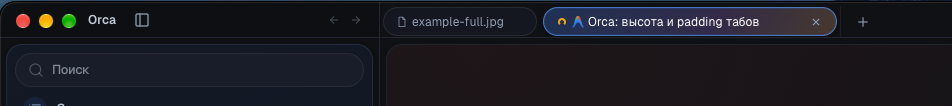

# Avari Glow for Orca

Тёмная тема для Orca с холодными синими поверхностями, тёплыми акцентами и мягким свечением. Проект объединяет тему интерфейса и терминала с необязательной утилитой для более глубокого оформления.



*Фрагмент реального интерфейса; внешний вид зависит от версии Orca и выбранных твиков.*

## Галерея

### Поле ввода

Градиентная рамка и мягкое свечение поля ввода — часть дополнительного твика `composer`.


### Визуальное направление

Общий вид ниже — ранний концепт, а не скриншот работающей темы. Он показывает настроение, палитру и направление оформления.


## Что внутри

- **Avari Glow** — плагин с темой интерфейса, подсветкой редактора и палитрой терминала.
- **Avari Orca Tweak** — экспериментальная утилита для вкладок, панелей, поля ввода, эффектов и необязательной иконки Dock.
- [Заметки для сопровождения](docs/MAINTENANCE.md) — где искать сломавшиеся селекторы после обновления Orca.

Тема работает отдельно от твика. Плагин рассчитан на Orca **1.4.246 и новее**; твик привязан к внутренней разметке и проверялся на локальной версии Orca 1.4. Работа на более новых версиях не гарантируется. Команды ниже предназначены для macOS; для сборки нужен Go 1.27.3 или новее и доступная в PATH команда `orca`.

## Установка

Клонируйте репозиторий в постоянную папку: Orca загружает плагин из неё в режиме разработки.

```sh
git clone https://github.com/OstKost/orca-avari-glow-theme.git
cd orca-avari-glow-theme
orca plugin validate ./avari-glow-theme
orca plugin dev load "$(pwd)/avari-glow-theme"
```

В настройках Orca выберите **Avari Glow** отдельно для интерфейса и для терминала. Не перемещайте папку после загрузки; если переместили, загрузите плагин заново из нового пути.

### Дополнительные твики

Также доступен экспериментальный [плагин с панелью твиков](https://github.com/OstKost/avari-glow-orca-tweaks). Он требует полного доступа и установленного Go; установка плагина сама по себе твики не применяет.

Твик изменяет файлы внутри `Orca.app`, включая CSS и загрузчик; это нарушает подпись пакета приложения и может повлиять на проверку целостности и обновления. Обновление Orca может удалить изменения или изменить внутреннюю разметку. Утилита создаёт резервные копии и не запрашивает повышение прав. Перед применением полностью закройте Orca.

```sh
cd avari-orca-tweak
go build -o avari-orca-tweak .
./avari-orca-tweak status
./avari-orca-tweak tui
```

В меню используйте стрелки и Enter; в разделе выбора твиков Enter или пробел переключает пункт. Выберите «Применить выбранные твики», затем запустите Orca снова. Эффекты движения отключаются системной настройкой уменьшения движения.

Для командного режима:

```sh
./avari-orca-tweak apply --features tabs,aurora,panels,composer
./avari-orca-tweak status
./avari-orca-tweak revert
```

Доступные группы: `tabs` — вкладки, `aurora` — активная рабочая область, `panels` — панели и границы, `composer` — поле ввода, `badges` и `chips` — мелкие элементы. `apply` заменяет текущий набор выбранным. Для нестандартного пути используйте, например, `--app /путь/Orca.app` после команды.

### Иконка Dock

В TUI доступны установка и восстановление иконки; те же действия можно выполнить командами `./avari-orca-tweak icon-apply` и `./avari-orca-tweak icon-revert`. Закройте Orca перед изменением и перезапустите после него. macOS может некоторое время показывать старую иконку из кэша.

## Откат и обновление

Перед обновлением Orca рекомендуется выполнить `revert` и, если меняли иконку, `icon-revert`. Откат CSS удаляет блок Avari, сохраняя прочие изменения; загрузчик и иконка восстанавливаются только при совпадении с ожидаемым состоянием. Резервные копии `.original`, `.bak.*` и `index.html.avari-original` остаются рядом с изменёнными файлами. После обновления проверьте совместимость и при необходимости примените твики снова. `status` показывает запись на диске, а не результат в работающем интерфейсе.

## Разработка

```sh
orca plugin validate ./avari-glow-theme
cd avari-orca-tweak
go test ./...
go build -o avari-orca-tweak .
```

CSS и скрипт эффектов встраиваются в утилиту при сборке, поэтому после их изменения её нужно пересобрать. Тема находится в `avari-glow-theme/`, код утилиты — в `avari-orca-tweak/`. Визуальное направление вдохновлено концептом @SIREN.UIX. Orca и её названия принадлежат своим владельцам; проект не является официальным плагином Orca.
